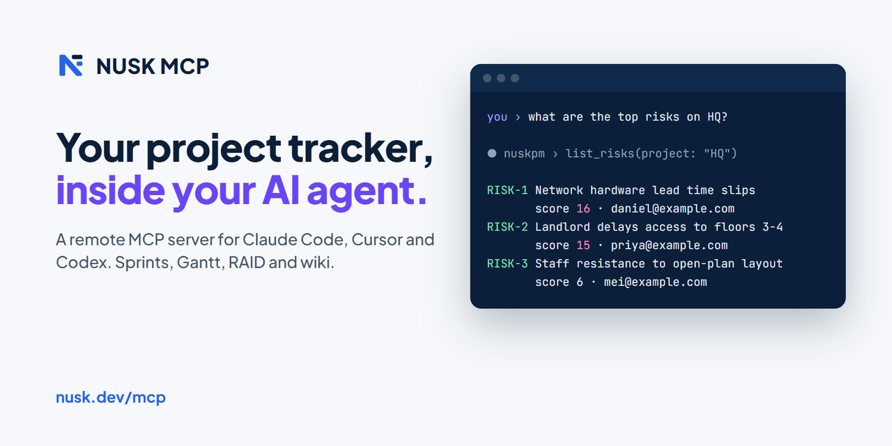
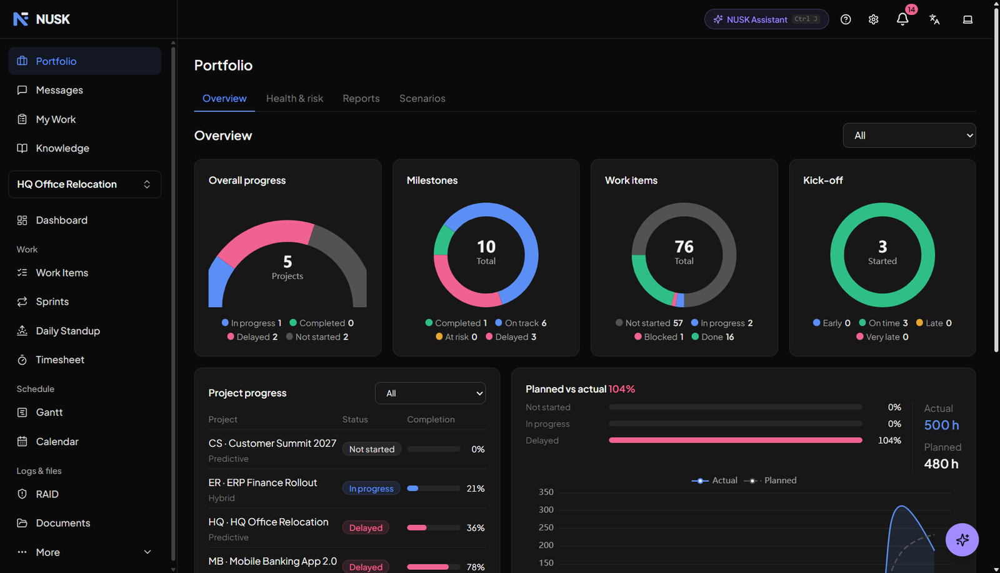
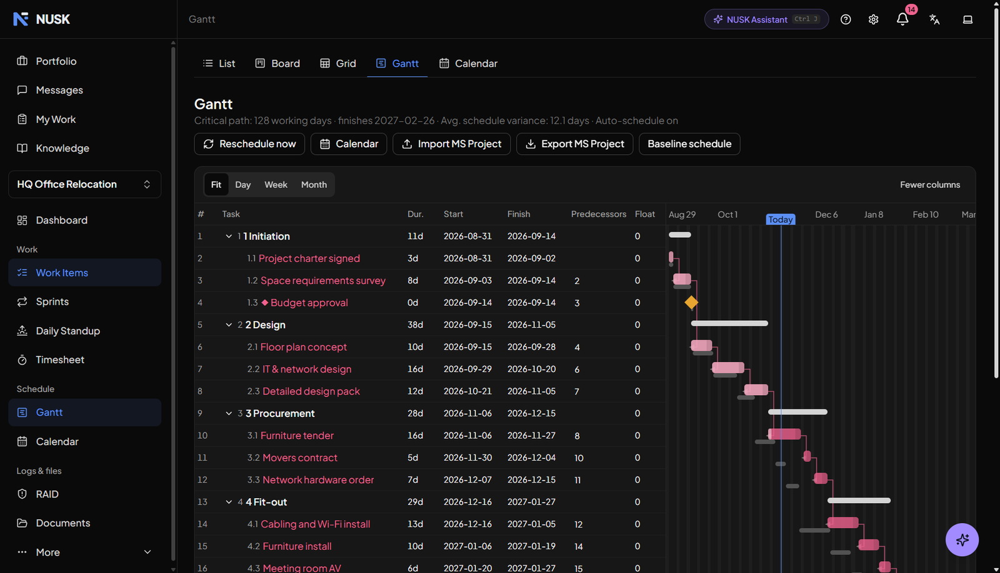
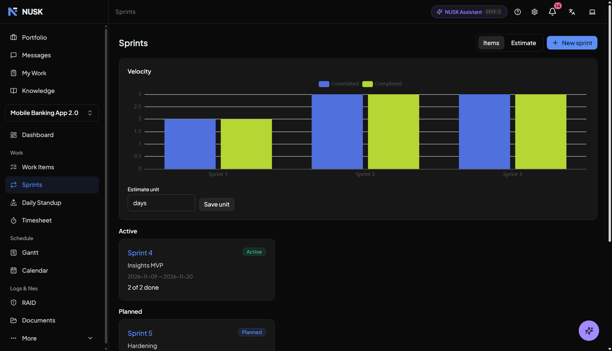
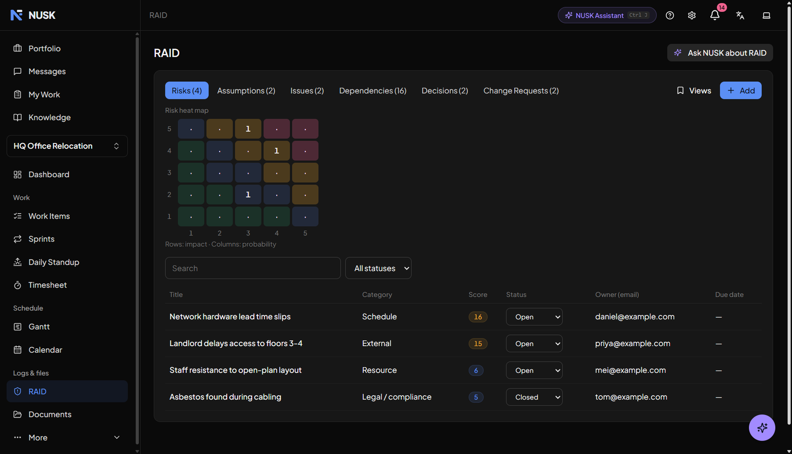

<div align="center">


# Nusk MCP

**Let your AI agent read and update your projects.**<br>
A remote [MCP](https://modelcontextprotocol.io) server for [Nusk](https://nusk.dev/?utm_source=github&utm_medium=readme&utm_campaign=nusk-mcp), a project management tool with sprints, Gantt schedules, RAID logs and a wiki.

[](LICENSE)
[](https://modelcontextprotocol.io)
[](#tools)
[](https://nusk.dev/mcp?utm_source=github&utm_medium=badge&utm_campaign=nusk-mcp)



</div>

## What this is

Nusk is where your team keeps tasks, schedules, risks and docs. This server lets an AI agent, such as Claude Code, Cursor or Codex, work with that same data from your editor or terminal. You skip the copy and paste between the tracker and the chat.

Ask things like:

- "What is on my plate this week?"
- "What are the top risks on project HQ?"
- "Which tasks are on the critical path?"
- "Create a task under HQ-12 for the login timeout bug and add it to the current sprint."

The server runs on nusk.dev. This repository holds the setup guide, config examples and the registry file. There is no code to install.

## Quick start

You need a Nusk workspace. If you don't have one, [create one](https://nusk.dev/signup?utm_source=github&utm_medium=readme&utm_campaign=nusk-mcp).

**1. Connect your agent.** Replace `YOUR-WORKSPACE` with your workspace name (the part after `nusk.dev/` in the address bar). There is no token to create: you sign in through your browser.

Claude Code:

```bash
claude mcp add --transport http nuskpm https://nusk.dev/YOUR-WORKSPACE/api/mcp
```

Then type `/mcp` in Claude Code, pick `nuskpm` and choose **Authenticate**.

Cursor, VS Code and other clients that read `mcp.json` ([file](examples/cursor-mcp.json)):

```json
{
  "mcpServers": {
    "nuskpm": {
      "url": "https://nusk.dev/YOUR-WORKSPACE/api/mcp"
    }
  }
}
```

**2. Sign in.** The client opens a Nusk page in your browser. Check the client name, choose **Read only** (start here) or **Read and change**, and click **Allow**.

### With a personal access token

Use a token for Codex, scripts, CI, or any client that can't open a browser sign-in. In Nusk, open **Profile → API tokens**, create one (start with **read-only**) and copy it; it is shown once.

Claude Code:

```bash
claude mcp add --transport http nuskpm \
  https://nusk.dev/YOUR-WORKSPACE/api/mcp \
  --header "Authorization: Bearer nusk_..."
```

Clients that read `mcp.json`: add `"headers": { "Authorization": "Bearer nusk_..." }` next to `url`.

Codex, in `~/.codex/config.toml` ([file](examples/codex-config.toml)):

```toml
[mcp_servers.nuskpm]
url = "https://nusk.dev/YOUR-WORKSPACE/api/mcp"
bearer_token_env_var = "NUSKPM_TOKEN"
```

Any client that supports remote HTTP MCP servers should work: with OAuth sign-in (RFC 9728 and 8414 discovery, dynamic client registration, PKCE S256) or a bearer header. Support for adding servers by URL in web apps such as claude.ai varies by app and plan.

**3. Ask a question.** Try `list my projects`. If the agent answers with your project codes, you're connected.

Self-hosting Nusk? The address is `https://<your-server>/api/mcp`.

## What it looks like

These are real screens from the sample workspace the tools read from.

| | |
|---|---|
|  |  |
| **Portfolio.** Progress across all projects. | **Gantt.** Dependencies, float and critical path (`get_schedule`). |
|  |  |
| **Sprints.** Velocity and sprint contents (`list_sprints`). | **RAID.** Risks, issues, assumptions, dependencies (`list_risks`). |

## Tools

30 tools. Sixteen only read data. Fourteen change data and are hidden when you use a read-only token.

### Read

| Tool | What it does |
|---|---|
| `list_projects` | Projects you belong to, with your role |
| `list_templates` | Built-in and saved project templates |
| `my_work` | Your open work items, soonest due first |
| `search` | Find work items by words in the title or key |
| `list_work_items` | Work items, filtered by status, owner, sprint or type |
| `get_work_item` | One item in full: description, acceptance criteria, parent, children, comments |
| `work_item_options` | Allowed types, priorities and statuses |
| `list_sprints` | Sprints with dates, status and done/total counts |
| `list_risks` | Risks, highest score first |
| `list_issues` | Issues |
| `list_assumptions` | Assumptions |
| `list_dependencies` | Dependencies |
| `get_schedule` | Dates, durations, float and critical flags, plus the work calendar |
| `list_wiki_pages` | The wiki page tree |
| `get_wiki_page` | One page, its path, child pages and backlinks |
| `import_status` | Recent imports and whether they were rolled back |

### Write

| Tool | What it does |
|---|---|
| `create_project` | Create a project. You become its admin |
| `create_work_item`, `create_work_items` | Create one or many work items |
| `update_work_item` | Change fields on an item |
| `move_to_iteration` | Move items between sprints |
| `add_comment` | Comment on an item |
| `add_risk`, `add_issue`, `add_assumption`, `add_dependency` | Add RAID entries |
| `create_minutes_action_items` | Turn meeting-minute actions into tasks |
| `create_wiki_page` | Create a wiki page, optionally from a template |
| `reschedule_project` | Recalculate dates from dependencies and the work calendar |
| `delete_work_item` | Delete one item. Needs the delete permission |

Projects are named by their two-letter code, for example `HQ`. Work items use keys such as `HQ-0012`.

## Safety

- **The agent is you.** It has your project roles and nothing more. It cannot see or change what you can't.
- **Read-only access** (chosen at sign-in, or a read-only token) exposes only the read tools.
- **Short-lived sign-in.** A browser sign-in gives a one-hour access token that renews itself with a rotating 30-day refresh token. It appears under Profile → API tokens as `OAuth: <client>`; delete it to end the connection.
- **Tokens expire.** For personal access tokens you choose the expiry, and you can revoke one any time under Profile → API tokens.
- **Changes are traceable.** Edits made through MCP are marked "via AI agent (MCP)" in revision history and can be reverted.
- **Rate limit:** 600 requests per minute per token.

Treat a personal access token like a password. Don't commit it. Use an environment variable where your client supports it, as in the Codex example.

## Troubleshooting

| You see | Fix |
|---|---|
| `Sign in with OAuth, or use a personal access token (Profile > API tokens)` | Not signed in yet. In Claude Code, run `/mcp` and authenticate; otherwise add a `Bearer nusk_...` header. |
| Sign-in page says the request is not valid or has expired | Start the connection again from your agent; the request lasts a few minutes. |
| `No project XX (list_projects shows yours)` | Wrong project code, or you aren't a member. Run `list_projects`. |
| Agent only offers read tools | The token is read-only. Create a read-and-write token. |
| 404 on the URL | Check the workspace name in the address. |

## Try Nusk without installing anything

- [Live demo](https://nusk.dev/demo?utm_source=github&utm_medium=readme&utm_campaign=nusk-mcp): a sample workspace with three projects, no signup. It lasts one hour. Connecting an agent needs your own workspace.
- [Full MCP guide](https://nusk.dev/mcp?utm_source=github&utm_medium=readme&utm_campaign=nusk-mcp)
- [Features](https://nusk.dev/features?utm_source=github&utm_medium=readme&utm_campaign=nusk-mcp)
- [Jira alternative](https://nusk.dev/jira-alternative?utm_source=github&utm_medium=readme&utm_campaign=nusk-mcp): how Nusk compares and how to import your Jira issues
- [Self-hosted option](https://nusk.dev/self-hosted?utm_source=github&utm_medium=readme&utm_campaign=nusk-mcp): run Nusk on your own servers
- [Learn project management](https://nusk.dev/learn-project-management?utm_source=github&utm_medium=readme&utm_campaign=nusk-mcp)

## Feedback

Missing a tool? Something broke? [Open an issue](../../issues/new/choose). A bug report with the tool name and the error text gets fixed fastest. If Nusk is useful to you, a star helps other people find it.

## License

The docs and examples in this repository are MIT licensed ([LICENSE](LICENSE)). The Nusk service, name and logo are not part of that license.
